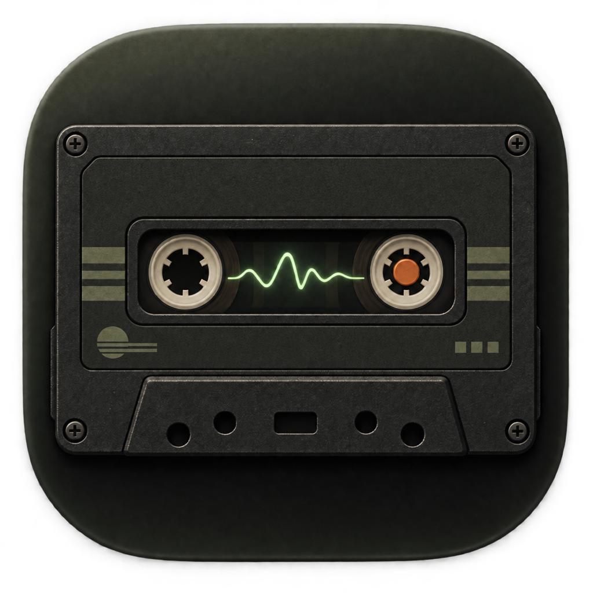
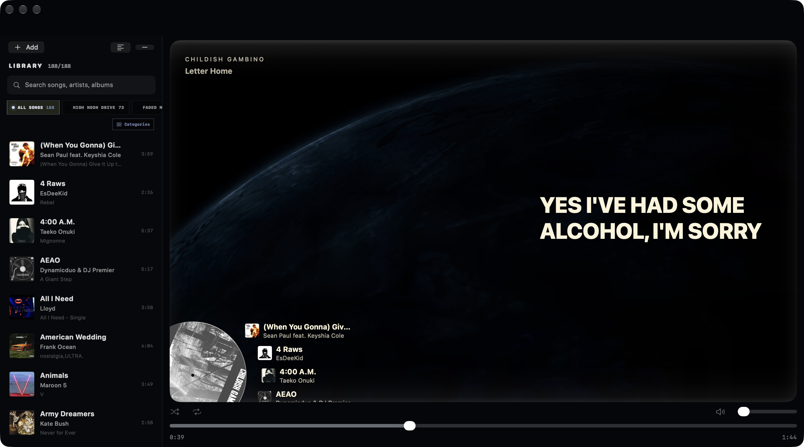
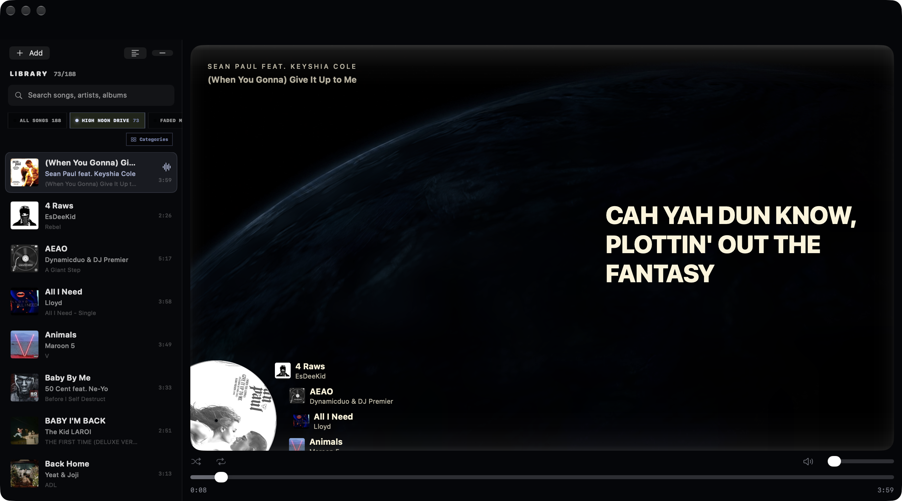

<p align="center">
  
</p>

<h1 align="center">Aftertone</h1>
<p align="center">Your music. A quieter screen.</p>
<p align="center">
  A native macOS player for your own music library, with synchronized lyrics,<br>
  rotating album artwork, and a slowly moving Earth backdrop.
</p>
<p align="center">
  <a href="https://github.com/jk2005-alt/aftertone/releases/latest">Download for Mac</a> ·
  <a href="#getting-started">Getting started</a> ·
  <a href="#build-from-source">Build from source</a> ·
  <a href="https://github.com/jk2005-alt/aftertone/issues">Report an issue</a>
</p>
<p align="center"><strong>macOS 14+ · Apple silicon · MIT licensed</strong></p>



## Made for listening

Aftertone brings your local library into a focused, dark interface. Album artwork becomes a rotating disc, lyrics follow the recording, and the background moves while music plays.

- **Local playback.** Import your MP3 files and listen offline. No streaming subscription or Aftertone account is required.
- **Lyrics on your terms.** Import timed LRC files, paste plain lyrics, or edit existing lyrics. Available lyrics can also be fetched from LRCLIB and cached locally.
- **An album disc that is also a control.** Click the rotating album disc to pause playback. Click it again to resume; the animation follows the playback state.
- **Simple library tools.** Add songs, edit metadata, search your collection, and remove tracks without touching the original files.
- **A focused listening view.** Double-click the lyrics area to enter full screen. Press Escape to return.

> The screenshots show a personal library for demonstration. The download starts without bundled music. No songs, lyric files, or album-art collection are included.

## Download

**[Download the latest Aftertone release →](https://github.com/jk2005-alt/aftertone/releases/latest)**

The current release supports **Apple-silicon Macs running macOS 14 or later**. An Intel Mac or Windows build is not included.

1. Download `Aftertone-macOS-arm64.zip` from the release page.
2. Extract the ZIP and drag **Aftertone.app** into **Applications**.
3. Open Aftertone and add your music.

This community release is ad-hoc signed and **not Apple-notarized**. macOS may block its first launch. If you trust the downloaded release, use **System Settings → Privacy & Security → Open Anyway** after attempting to open it. See [Apple’s instructions](https://support.apple.com/en-us/102445). You can also build the app yourself below.

A SHA-256 checksum is provided with each release.

## Getting started

### Add your music

Choose **Add** at the top left and select one or more MP3 files. Review the song title, artist, and album, then save. Aftertone creates its own local copy; your source file is left unchanged. Album artwork embedded in imported files is used when available.

### Playback controls

| Action | Control |
| --- | --- |
| Play a song | Select it in the library or the circular song list |
| Pause / resume | Click the album disc; Space also toggles playback |
| Seek | Drag the progress bar |
| Jump backward / forward | Command–Left Arrow / Command–Right Arrow |
| Adjust volume | Use the slider at the bottom right |
| Shuffle / repeat | Use the controls below the listening view |
| Full-screen lyrics | Double-click the lyrics area; Escape exits |
| Remove a song | Select it, then choose the minus button at the top left |

### Organize categories

Open **Categories**, enter a name, and choose **Add**. Use the minus control beside a category to remove it. Removing a category keeps all of its songs in **All Songs**.

To organize a track, right-click it and choose **Move to Category**. A song belongs to one category at a time; choose **All Songs only** to clear its assignment. Your categories and assignments persist between launches.

### Add or edit lyrics

Select a song and choose the **lyrics icon** next to Add. You can also right-click a song and choose **Add or Edit Lyrics…**.

Import an `.lrc` file for synchronized lyrics, or paste plain text for a scrollable reading view. Save to keep the lyrics with that song. Timing comes from the LRC file; pasting plain lyrics does not automatically synchronize them. Use an LRC that matches your particular recording—live, shortened, and alternate versions may have different timings.

<details>
<summary>Another view of the listening screen</summary>



</details>

## Local storage and network use

Your imported files and saved lyrics are stored in `~/Library/Application Support/Auralis/`. The folder retains the app’s original internal name. Removing an imported song deletes Aftertone’s copy and its saved lyrics, not the source file.

Playback uses local files. When local lyrics are unavailable, automatic lyric search sends the song title and artist to **LRCLIB**. Cached and imported lyrics work offline. The source also includes optional Discord Rich Presence support; it requires a separately configured Discord application ID and a running desktop client.

## Build from source

Install Xcode, select its command-line tools, and use an Apple-silicon Mac:

```sh
git clone https://github.com/jk2005-alt/aftertone.git
cd aftertone
./Scripts/build_app.sh
open build/Aftertone.app
```

The build uses SwiftUI, AppKit, AVFoundation, and Metal through the macOS SDK. No third-party package manager is required. It produces an ad-hoc-signed app in `build/Aftertone.app`; it never downloads or bundles a music library.

## Project status

Aftertone began as a personal player and is now available as an initial public release. Core playback and library tools are ready to try. Lyric availability and timing depend on the source file, and you can add your own categories alongside the built-in suggestions.

Found a problem? [Open an issue](https://github.com/jk2005-alt/aftertone/issues) with your macOS version, Mac chip, and steps to reproduce it. Please do not attach music files or full lyrics.

## Contributing and license

See [CONTRIBUTING.md](CONTRIBUTING.md) for build and contribution guidance. Source code and original app assets are available under the [MIT license](LICENSE). Third-party artwork and lyric excerpts visible in screenshots retain their respective owners’ rights; see [NOTICE.md](NOTICE.md).
